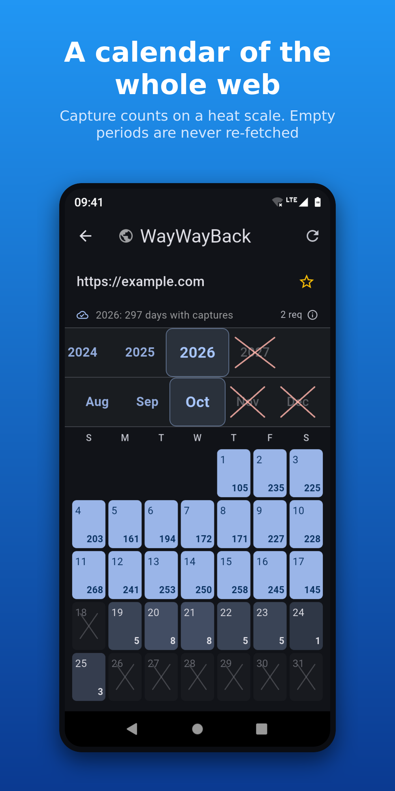
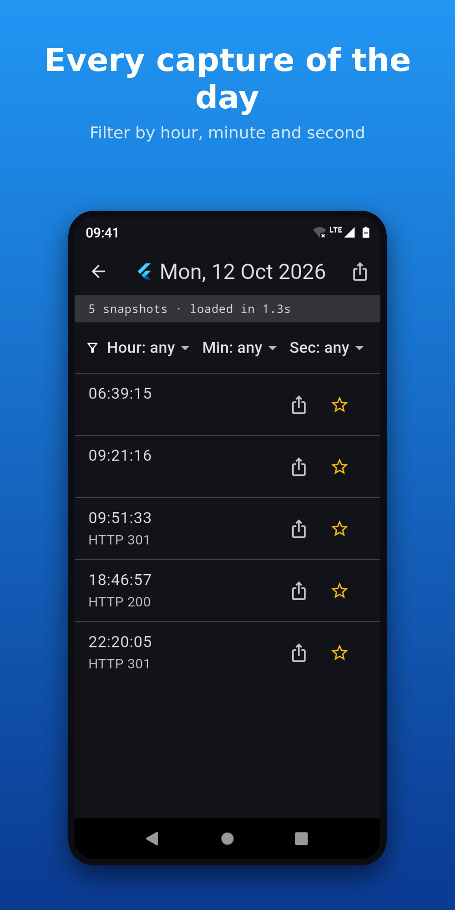
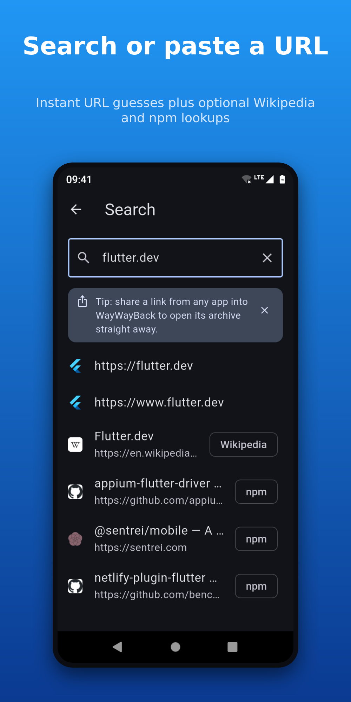
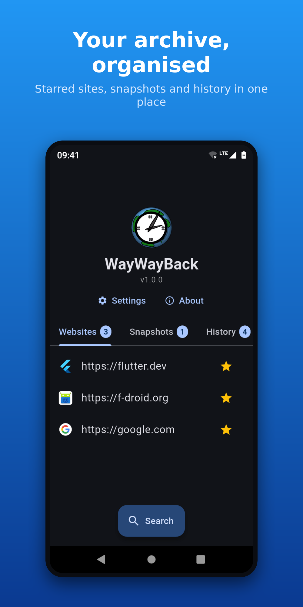
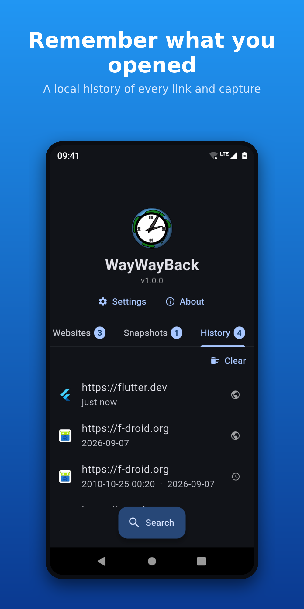
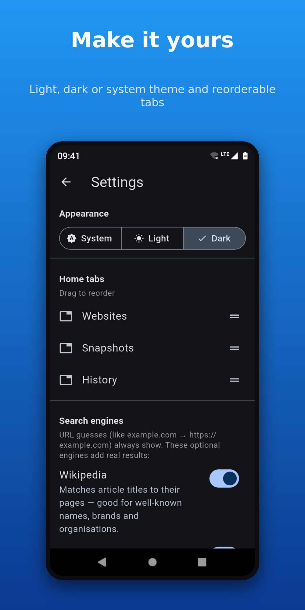
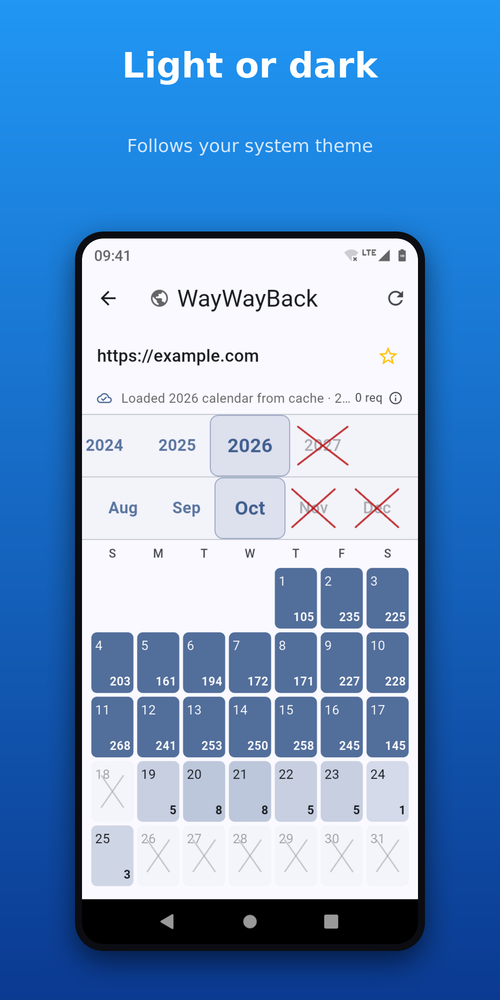
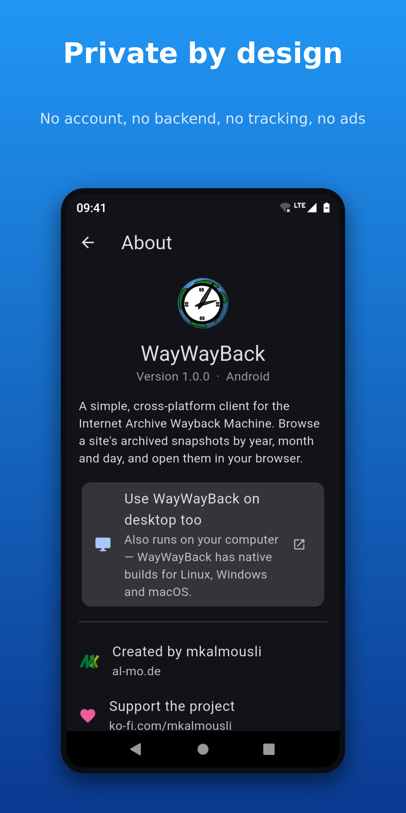
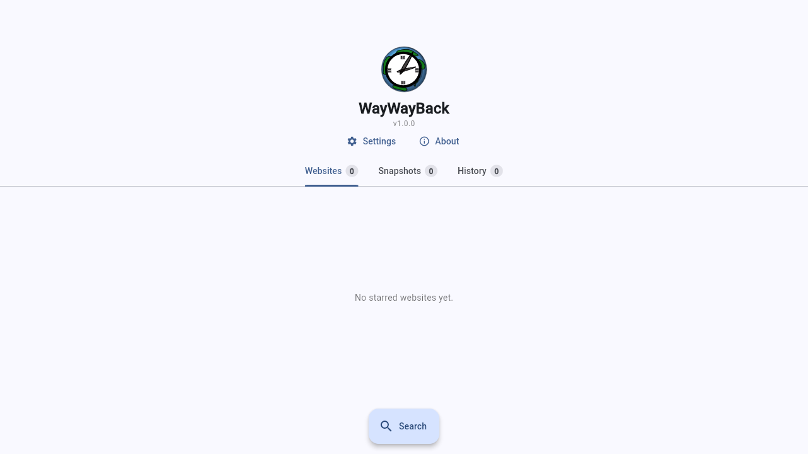

<div align="center">


# WayWayBack

**A free, open-source Wayback Machine app for Android, Linux, Windows and macOS.**

Search for a site, then walk its Internet Archive history on a heat-map calendar —
year → month → day — and open any snapshot in your browser.

[**Website & demo videos**](https://mkalmousli.github.io/wwb/) · [**Download**](https://github.com/mkalmousli/wwb/releases/latest) · [Report an issue](https://github.com/mkalmousli/wwb/issues)

[](https://github.com/mkalmousli/wwb/releases)
[](https://github.com/mkalmousli/wwb/actions/workflows/release.yml)
[](https://mkalmousli.github.io/wwb/)
[](LICENSE)
[](https://flutter.dev)

<br>

   

</div>

---

## Features

Every feature has a short demo video on the [website](https://mkalmousli.github.io/wwb/).

| | |
|---|---|
| [**Year → month → day calendar**](https://mkalmousli.github.io/wwb/features/calendar/) | Every day cell shows its capture count on a heat scale. Empty years, months and days are crossed out and never requested. |
| [**Fast by design**](https://mkalmousli.github.io/wwb/features/calendar/) | Uses the Wayback Machine's own `sparkline` and `calendarcaptures` endpoints, fetches only the selected year and caches locally. |
| [**Per-day snapshot list**](https://mkalmousli.github.io/wwb/features/snapshots/) | Time and HTTP status for each capture, with hour / minute / second filters that only offer times that exist. |
| [**Smart search**](https://mkalmousli.github.io/wwb/features/search/) | Instant URL guesses plus optional keyless **Wikipedia** (article → homepage) and **npm** (package → repository) lookups; recent searches are remembered. |
| [**Stars & history**](https://mkalmousli.github.io/wwb/features/stars-and-history/) | Star sites and snapshots; keep a local history of every link and capture you opened. |
| [**Share to open**](https://mkalmousli.github.io/wwb/features/share-to-open/) | Share a URL into WayWayBack from any app, or use `wwb://open?url=…` deep links. |
| [**Themes & layout**](https://mkalmousli.github.io/wwb/features/themes/) | Light / dark / system, drag-to-reorder home tabs. |
| [**Private**](https://mkalmousli.github.io/wwb/features/privacy/) | No account, no backend, no tracking, no ads. Everything stays on your device. |

## Screenshots

<p align="center">
   
</p>

<p align="center"></p>

## Install

- **Android:** grab an APK from the
  [latest release](https://github.com/mkalmousli/wwb/releases/latest)
  (`arm64-v8a` for most phones; `universal` works anywhere).
- **F-Droid:** the [`build.py`](build.py) reproducible build and
  [`metadata/`](metadata) are ready; an inclusion request is planned.
- **Desktop:** download the archive for your OS from the release, or build from
  source (below).
  - *Linux:* extract and run `./wwb` (needs GTK 3).
  - *Windows:* extract and run `wwb.exe`.
  - *macOS:* the `.app` is unsigned, so run
    `xattr -dr com.apple.quarantine WayWayBack.app` once, then open it.

## Build from source

Requires the [Flutter SDK](https://docs.flutter.dev/get-started/install)
(pinned to **3.41.9** in [`.fvmrc`](.fvmrc)).

```sh
flutter pub get
dart run build_runner build      # generates the drift database code
flutter run -d android           # or: linux / windows / macos
```

### Reproducible APK

The release APK is built by [`build.py`](build.py), which pins the Flutter
version and builds at a fixed path so the output is byte-for-byte identical on
CI, in Docker and on the F-Droid server:

```sh
docker build -t wwb-build .
docker run --rm -v "$PWD":/tmp/app wwb-build /tmp/app/build.py   # -> app.apk
```

To sign it, drop a keystore next to `android/app/` and create
`android/key.properties` (both git-ignored):

```properties
storeFile=your-keystore.jks
storePassword=…
keyAlias=…
keyPassword=…
```

Without a key the build is debug-signed — fine for local use, and F-Droid
strips the signature when it verifies reproducibility anyway.

### GitHub Actions secrets

The [release workflow](.github/workflows/release.yml) signs and publishes the
APK only when these repository secrets are set
(**Settings → Secrets and variables → Actions**):

| Secret | Value |
|---|---|
| `KEYSTORE_BASE64` | the keystore file, base64-encoded: `base64 -w0 your-keystore.jks` |
| `KEYSTORE_PASSWORD` | store password |
| `KEY_ALIAS` | key alias |
| `KEY_PASSWORD` | key password |

If they are absent the workflow still runs as a reproducibility check but skips
publishing, and the maintainer uploads a locally-signed APK to the release
instead. Keep the same keystore forever — F-Droid pins its fingerprint in
[`metadata/`](metadata) (`AllowedAPKSigningKeys`).

## How it works

```
lib/
  app.dart · main.dart          MaterialApp, theme, deep-link routing
  core/                         http client, favicon, theme, deep links, helpers
  data/
    wayback/wb_calendar.dart    __wb sparkline + calendarcaptures endpoints
    search/*                    URL guesser, Wikipedia, npm
    local/                      drift (SQLite) — sites, snapshots, settings,
                                history + tab order, TTL cache
  features/
    home/ search/ settings/ about/ day/
    link/                       link_controller.dart + scroll_selector,
                                month_calendar, request_details_dialog
```

Layers stay separated: **data → state (Riverpod) → UI**.

## Legal

WayWayBack is an **independent, unofficial** client. It is **not** the Wayback
Machine and is **not affiliated with, endorsed by, or connected to the Internet
Archive**. It has no backend of its own — it talks directly to the public
`web.archive.org` endpoints and stores all data locally on your device. All
archived content, trademarks and service marks belong to their respective owners.

## License

[GNU General Public License v3.0 or later](LICENSE). This program comes with
**absolutely no warranty**.
